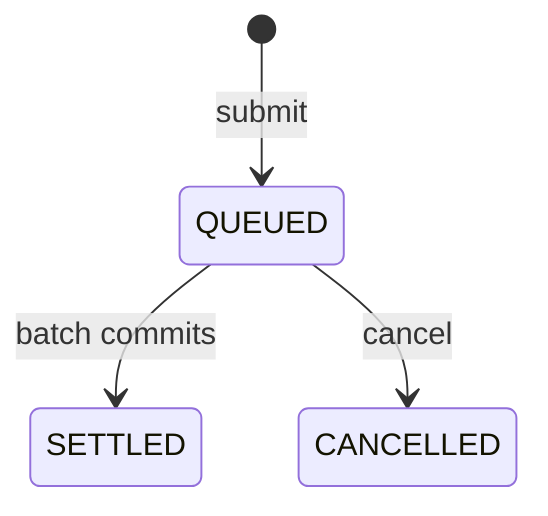

```sh
docker compose up -d --wait
./gradlew -q run --args="pg race cancel-first"
./gradlew -q run --args="pg race settle-first --drop-reply"
```

# Settlement Lab

A, B and C have 20 units each and owe 100 around a ring. None can pay first. Together they can settle 300 with 60 units of cash, unless C cancels its payment first. The two commands race cancellation against settlement on independent PostgreSQL 18 connections. Each creates a fresh domain with the same opening balances and obligations.

Run the quickstart from the checkout with JDK 21 and Docker Compose in Windows PowerShell or a Linux shell. Set `JAVA_HOME` to the JDK directory when another Java version is the default. In Windows Command Prompt use `gradlew.bat` for `./gradlew`. Compose downloads the pinned database image and the Gradle Wrapper downloads the build tools and dependencies on first use.

| First writer | What PostgreSQL commits |
| --- | --- |
| Cancel | C's payment becomes `CANCELLED`. The waiting settlement sees the cancellation and rejects the entire batch. Two payments remain queued, gross settled is 0 and all balances stay at 20. |
| Settle | The three payments become members of one batch. Gross settled is 300 and all balances stay at 20. The waiting cancellation returns `ALREADY_SETTLED` with the batch ID. |

Look for `wait_event_type=Lock` and the three backend PIDs. The first writer holds the domain row until the observer sees its PID in PostgreSQL's list of blockers for the second writer. With `--drop-reply`, the demo closes the winning session after its commit and withholds the reply. It resends the same command on a fresh connection and prints `reply_recovered=true` once the result matches the stored receipt.

## Inspect and verify a run

Before either writer starts, the CLI prints the domain, command IDs, batch, snapshot revision and payment IDs. Keep these lines to look up or repeat the same command after an interruption. Copy `domain` and `settle_command` into the commands below in place of `DOMAIN` and `COMMAND`. A snapshot shows the live payment states. An export captures that domain's accounts, payments, batches, events and receipts in a versioned JSON file for offline verification.

```sh
./gradlew -q run --args="pg snapshot DOMAIN"
./gradlew -q run --args="pg receipt DOMAIN COMMAND"
./gradlew -q run --args="pg export DOMAIN build/history.json"
./gradlew -q run --args="verify build/history.json"
```

The verifier replays the history from the opening balances, checks the identities of the settled members and reports the conserved balance and gross settled. A contradictory history exits with an error. For your own fixture, first run `./gradlew -q run --args="pg migrate"`. The CLI help lists commands to open a domain, submit or cancel a payment, settle a proposed group and inspect a payment by ID. Run `./gradlew -q run --args="--help"`.

The local database listens on `127.0.0.1:55432`. Its database name, user and password are `settlement_lab`. For a different host port, set `SETTLEMENT_PORT` before starting Compose and set `SETTLEMENT_JDBC_URL` to the matching URL, such as `jdbc:postgresql://127.0.0.1:55433/settlement_lab`. The client also accepts `SETTLEMENT_DB_USER` and `SETTLEMENT_DB_PASSWORD`. Use `docker compose down` to stop the lab while retaining its named volume. Starting it again reconnects to the stored history. [Compose configuration](compose.yaml)

**Windows time zones.** pgJDBC sends the JVM's time-zone ID when it connects. A Windows JVM can report `America/Buenos_Aires`, an alias missing from the Debian Trixie image's time-zone data. PostgreSQL then rejects the connection with SQLSTATE `22023`. Gradle's `run` task, the distributed launchers and the tests use `-Duser.timezone=UTC` in their JVMs. Windows keeps the host's configured time zone. [JVM configuration](build.gradle) · [pgJDBC startup parameters](https://github.com/pgjdbc/pgjdbc/blob/REL42.7.14/pgjdbc/src/main/java/org/postgresql/core/v3/ConnectionFactoryImpl.java#L422-L429)

## In-memory fixtures

With just the JDK, run the original F0 examples in Windows PowerShell or a Linux shell.

```sh
./gradlew -q run --args="demo cycle"
./gradlew -q run --args="demo cycle --race cancel-first"
./gradlew -q run --args="demo unequal"
```

Each `demo` invocation opens a fresh in-memory ledger. Its `--race` option chooses the order of two sequential operations. The default for the equal cycle is `settle-first`. The payment IDs `AB`, `BC` and `CA` identify transfers in the direction indicated by their letters.

| Fixture | Manual calculation | Closing state |
| --- | --- | --- |
| Equal cycle, settlement first | A alone would close at 20 − 100 = −80. In the group, each account closes at 20 + 100 − 100 = 20. | All three payments belong to batch `cycle`. Cancelling `CA` returns `ALREADY_SETTLED` and identifies that batch. |
| Equal cycle, cancellation first | Cancelling `CA` removes A's incoming 100. The original proposal contains a cancelled member. Proposing just `AB` and `BC` would still leave A at −80. | Both proposals are rejected. `AB` and `BC` stay queued, `CA` stays cancelled, and each account keeps its 20. |
| Unequal cycle | Start at zero. Payments of 100, 100 and 90 would close A at −10, B at 0 and C at +10. | The batch is rejected. All three payments stay queued and each balance stays at zero. |

## Select a batch

```sh
./gradlew -q run --args="demo selection"
```

In the 100/100/100 ring, strict FIFO stops at the first payment and the multilateral heuristic settles 300. The second fixture gives A 5 and queues transfers of 4 and 5. The heuristic keeps the older transfer of 4, leaving a gap of 1 from the hand-calculated optimum of 5. The test oracle enumerates all subsets of windows up to 12 instructions. [Selection and authority decisions](docs/decisions.md)

For a persisted domain, `pg cycle DOMAIN fifo 32` or `pg cycle DOMAIN heuristic 32` attempts one batch. The CLI prints how many payments it inspected, whether the queue extends past the window, and the snapshot revision. A nonempty proposal includes a `replay=` line before the write. Use that exact `pg settle` command after an interrupted response. Each new `pg cycle` reads a fresh snapshot. Use `pg receipt DOMAIN COMMAND` to retrieve an existing decision.

## Settlement rules

The demo uses one simulated currency, `SIM`, with scale 0. One integer unit is the smallest transferable amount. Accounts open with a balance between 0 and `Long.MAX_VALUE`. Obligations may exceed the sender's available balance at submission.



A batch names 1 to 128 distinct queued payments. For each participant the ledger computes `current balance + incoming − outgoing` across the complete proposal. It uses `BigInteger` for the calculation and gross volume. Each batch must keep every closing balance in range and conserve the total cash of the accounts it touches. The system total therefore stays equal to the sum of its openings. A successful batch records its ID on every member. Both terminal states are permanent for the life of that ledger.

## Tests

```sh
./gradlew test
docker compose up -d --wait
./gradlew integrationTest
```

On Linux, `bash scripts/test-postgres.sh` runs the integration suite and terminal recovery checks on an isolated Compose project. It runs both race orders, restarts PostgreSQL on its original volume, and checks the exported history and receipt after replay from a new JVM. The script removes its temporary project when finished. If Docker reports that its predefined address pools are exhausted, set `SETTLEMENT_TEST_SUBNET` to an unused private CIDR before running the script. [Recovery check](scripts/test-postgres.sh) · [Architecture](docs/architecture.md)

The project uses the Gradle 9.9.2 Wrapper. Its distribution checksum is pinned in [gradle-wrapper.properties](gradle/wrapper/gradle-wrapper.properties). The Wrapper JAR has SHA-256 `621008afc4f5d59357fcf06ffa644dd5aade5e091bdc363742710445f73cdaf8`. Gradle publishes both reference values. [Distribution checksum](https://services.gradle.org/distributions/gradle-9.9.2-bin.zip.sha256) · [Wrapper JAR checksum](https://services.gradle.org/distributions/gradle-9.9.2-wrapper.jar.sha256)
