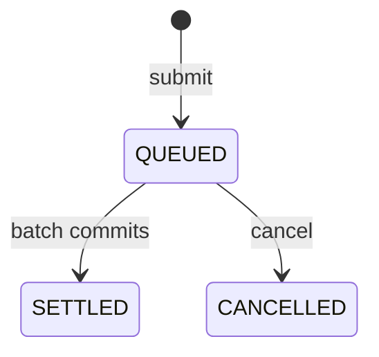

```sh
./gradlew -q run --args="demo cycle"
```

# Settlement Lab

Three participants have 20 units each. A owes B 100, B owes C 100, and C owes A 100. None can pay first. The command above tries A's payment on its own, settles all three together, then shows what happens when C tries to cancel. The batch settles 300 units of obligations with 60 units of cash. The closing balance of each participant is 20.

Run the command from the checkout in Windows PowerShell or a Linux shell with a JDK 21 installed. Set `JAVA_HOME` to the JDK directory when another Java version is the default. In Windows Command Prompt, use `gradlew.bat` in place of `./gradlew`. The first build downloads Gradle and the first test run downloads JUnit.

## Run the three fixtures

```sh
./gradlew -q run --args="demo cycle"
./gradlew -q run --args="demo cycle --race cancel-first"
./gradlew -q run --args="demo unequal"
```

Each invocation opens a fresh in-memory ledger. `--race` chooses the order of two sequential operations. The default for the equal cycle is `settle-first`. The payment IDs `AB`, `BC` and `CA` identify transfers in the direction indicated by their letters.

| Fixture | Manual calculation | Closing state |
| --- | --- | --- |
| Equal cycle, settlement first | A alone would close at 20 − 100 = −80. In the group, each account closes at 20 + 100 − 100 = 20. | All three payments belong to batch `cycle`. Cancelling `CA` returns `ALREADY_SETTLED` and identifies that batch. |
| Equal cycle, cancellation first | Cancelling `CA` removes A's incoming 100. The original proposal contains a cancelled member. Proposing just `AB` and `BC` would still leave A at −80. | Both proposals are rejected. `AB` and `BC` stay queued, `CA` stays cancelled, and each account keeps its 20. |
| Unequal cycle | Start at zero. Payments of 100, 100 and 90 would close A at −10, B at 0 and C at +10. | The batch is rejected. All three payments stay queued and each balance stays at zero. |

## Settlement rules

The demo uses one simulated currency, `SIM`, with scale 0. One integer unit is the smallest transferable amount. Accounts open with a balance between 0 and `Long.MAX_VALUE`. Obligations may exceed the sender's available balance at submission.



A batch names 1 to 128 distinct queued payments. For each participant the ledger computes `current balance + incoming − outgoing` across the complete proposal. It uses `BigInteger` for the calculation, gross volume and system totals. Before changing any payment or balance, it checks that every closing balance fits the range above and that their sum equals the sum of the openings. A successful batch records its ID on every member. Both terminal states are permanent for the life of that ledger.

## Tests and help

```sh
./gradlew test
./gradlew -q run --args="--help"
```

The demo runs in one process and discards state on exit. Persistence, concurrent settlement and recovery are later milestones. The architecture notes describe that boundary and the planned authority. [Architecture](docs/architecture.md)

The project uses the Gradle 9.9.2 Wrapper. Its distribution checksum is pinned in [gradle-wrapper.properties](gradle/wrapper/gradle-wrapper.properties). The Wrapper JAR has SHA-256 `621008afc4f5d59357fcf06ffa644dd5aade5e091bdc363742710445f73cdaf8`. Gradle publishes both reference values. [Distribution checksum](https://services.gradle.org/distributions/gradle-9.9.2-bin.zip.sha256) · [Wrapper JAR checksum](https://services.gradle.org/distributions/gradle-9.9.2-wrapper.jar.sha256)
