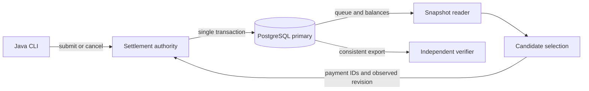

# Settlement Lab architecture

Settlement Lab studies how a group of indivisible payments can settle with limited cash. Its first milestone, F0, is an in-memory Java 21 terminal demonstration with synthetic obligations in one currency. It answers a mathematical question about a particular group of payments. The subsequent milestones add a durable authority, concurrent clients and a comparison of queue policies.

In F0, the [CLI fixtures](../src/main/java/lab/settlement/cli/Demo.java) call a single-threaded [ledger](../src/main/java/lab/settlement/settlement/Ledger.java) that owns each payment's status and batch membership. Its [position calculator](../src/main/java/lab/settlement/domain/BatchPositions.java) uses `BigInteger` for sums. Each CLI invocation starts fresh. The `--race` option chooses which operation runs first, so the two outcomes can be examined before introducing independent workers.

## A reference case

Three participants each open with 20 units. A owes B 100, B owes C 100 and C owes A 100. Paying any of the obligations first would overdraw the sender. Executing all three simultaneously leaves every balance at 20 and settles a gross amount of 300. Remove the C-to-A obligation before settlement and every nonempty subset of the remaining two would overdraw someone. With zero opening balances and obligations of 100, 100 and 90 around the original ring, A would finish at −10. A directed cycle alone does not establish feasibility.

For each participant, compute `closing = opening + incoming - outgoing` across the entire candidate. Each amount is positive and measured in whole minor units. Use exact integer arithmetic for intermediates. The target persistent representation permits balances from zero through the maximum signed 64-bit integer. Every accepted candidate must conserve total cash, respect each participant's balance bounds and settle each selected obligation in full. A net-zero cycle could be applied twice without changing any balance, which makes the identities of the settled obligations as important as the balances.

The reference case is inspired by liquidity-saving mechanisms. This project sets its own experimental rules. [Bank of England guide to the CHAPS liquidity-saving mechanism](https://www.bankofengland.co.uk/-/media/boe/files/payments/liquidity-saving-mechanism-user-guide.pdf)

## Planned durable authority

The following diagram describes the intended architecture from F1 onward.

The authority owns all writes to a settlement domain, including admissions and cancellations. A domain has one currency, fixed participants and opening balances, a queue and an increasing revision. A submitted payment stays queued until it settles in exactly one batch or a cancellation takes effect. Its terminal decision is permanent in the domain's history. A batch identifies its member payments. The verifier reconstructs balances from the openings and checks the memberships against the committed command, event history and terminal payment states.

### Selection and commit

1. Read the domain revision, the first bounded window of queued obligations by admission sequence, and their participants' balances in one short `REPEATABLE READ READ ONLY` transaction. Close the connection or transaction before searching for a candidate.
2. Select a candidate in Java. Include its payment IDs, the observed revision and the policy version in the proposal. The snapshot can become stale before the authority receives it.
3. On one JDBC connection, begin a `READ COMMITTED` transaction. Take a row lock on the domain with `SELECT ... FOR UPDATE`. Every writer follows the same discipline. Read the receipt, payments and balances in **subsequent SQL statements** so validation sees the transaction that released the lock. [PostgreSQL transaction isolation](https://www.postgresql.org/docs/18/transaction-iso.html)
4. Revalidate membership, eligibility and all affected balances. A multilateral batch requires feasible closing balances. A strict FIFO proposal must still be a prefix of the current queue. Applying that prefix in admission order must keep **every intermediate balance** within bounds. A stale pair of offsetting payments could pass the net check even if its first sender spent its cash after the snapshot.
5. On success, commit the batch, its exact membership, balances, new revision, history entry and command receipt together. A business rejection records a receipt without changing settlement state. Perform candidate search and external I/O outside the lock.

Multiple app instances may propose overlapping batches. The domain lock limits write throughput, but it also gives cancellation and settlement a single durable order. If cancellation commits first, the overlapping proposal is rejected in full. If settlement commits first, the cancelling client can retrieve the batch that settled its payment. Reading a timestamp at a client cannot determine which happened.

### Identity, retries and availability

| Identity | Responsibility |
| --- | --- |
| Payment ID | Identifies an obligation and its immutable terms within the domain. Another submission cannot create a duplicate with the same ID. |
| Command ID | Identifies one normalized request. Repeating it returns the same terminal receipt. Different terms under the same command ID conflict. |
| Batch ID | Identifies a committed group. Only a successful commit reserves this identity. |

A dropped reply after `COMMIT` leaves the client uncertain. Retrying the same command on the primary must recover the receipt or safely execute it if the original transaction rolled back. A missing receipt in a single read can also mean the first attempt is still in flight. The target assumes one writable PostgreSQL 18 primary, durable storage, `fsync` enabled and `synchronous_commit=on`. Losing the primary pauses admissions and settlements. Losing its storage or promoting an asynchronous replica can lose an acknowledged commit.

## How policies will be compared

Strict global FIFO takes the longest individually payable prefix in the window. The planned multilateral heuristic starts with the whole window and removes obligations until a feasible group emerges. It drops the most recent outgoing obligation of a deterministically selected deficit account, or the most recent incoming obligation of an account over its bound. Compare that result with FIFO and the empty set. Prefer higher gross volume, then more obligations, then the lexicographically earliest list of queue positions.

The reference oracle independently enumerates every subset for windows up to 12 payments. For example, A starts with 5 and owes B 4 then C 5. Dropping the most recent obligation selects 4. The optimum is 5. Report that difference alongside pending count and oldest pending age. Two policies use identical arrival times, cancellation order, window size, settlement opportunities and end time. An empty selection means that policy found no payable group within its window.

## Milestones and verification

| Milestone | Evidence |
| --- | --- |
| F0 · In-memory domain | Run the balanced ring, cancellation-before-settlement and unequal ring examples. Check per-account feasibility, total cash and the identities contributing to gross settlement. |
| F1 · Persistence | Store admissions, cancellations, proposals and receipts using JDBC, SQL migrations and a single PostgreSQL authority. |
| F2 · Contention and recovery | Use barriers and two real database connections to force both cancellation orders. Interrupt a transaction before commit, drop a reply after commit and retry. Verify the exported history in each case. |
| F3 · Selection quality | Compare bounded selection with global FIFO and the independent oracle. Retain both an improvement over FIFO and a suboptimal heuristic case as regression fixtures. |
| F4 · Operation | Publish workloads, seeds, correctness checks, lock wait, commit latency and unsettled queue ages with the hardware and durability settings. |
| F5 · Distribution | Run the documented demo from a clean distribution and verify migration compatibility once a previous version exists. |
