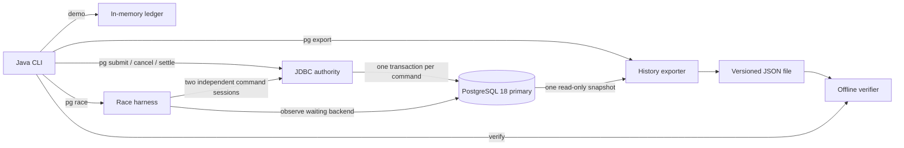
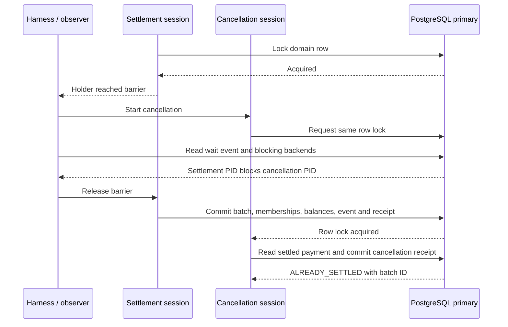

# Settlement Lab architecture

Settlement Lab studies whether a specific group of indivisible payments can settle with limited cash. A Java 21 CLI runs the same three-participant example against two authorities. The in-memory ledger demonstrates the arithmetic. The JDBC authority also answers which command took effect when two sessions raced and a caller lost the reply. [Terminal quickstart](../README.md)

## Settlement invariants

A domain has one simulated currency, a fixed set of accounts and immutable opening balances. An obligation has a positive integer amount, two distinct endpoints and a stable payment ID. It starts queued. Cancellation and settlement are terminal. Each settled payment identifies exactly one committed batch. An unpaid obligation may exceed its sender's balance.

A proposal names 1–128 distinct payments. For each participant, compute `current balance + incoming − outgoing` across all members using exact arithmetic. A batch is feasible when every closing balance is between zero and the maximum signed 64-bit integer. Its gross volume is the sum of member amounts, which can exceed 64 bits. The cash total equals the sum of the openings. A zero-net cycle could settle twice without changing any balance, so verification also needs the individual payment identities.

With openings of 20 each, the 100/100/100 ring settles 300 gross and closes each participant at 20. Removing C's obligation leaves A short by 80 if the remaining two settle. At zero openings, a 100/100/90 ring leaves A short by 10. The example is inspired by liquidity-saving mechanisms and uses its own experimental rules. [Bank of England guide to the CHAPS liquidity-saving mechanism](https://www.bankofengland.co.uk/-/media/boe/files/payments/liquidity-saving-mechanism-user-guide.pdf)

## Transaction boundary

Flyway creates the schema. The domain row holds a revision and a queue sequence counter. Each state-changing command appends one event at the next revision. A batch can change many payments at that revision. The payment's batch foreign key represents membership. [Initial migration](../src/main/resources/db/migration/V1__settlement_authority.sql)

1. The race fixture reads the current revision and queued payment IDs in one read-only `REPEATABLE READ` snapshot. It closes that transaction before either writer starts.
2. Each writer opens a separate JDBC connection and starts a `READ COMMITTED` transaction. Its first business statement locks the domain row with `SELECT ... FOR UPDATE`. After acquiring the lock it reads the receipt and current state in separate statements. Each of these statements sees the preceding writer's commit. [PostgreSQL transaction isolation](https://www.postgresql.org/docs/18/transaction-iso.html)
3. For a new settlement command, the authority checks the batch identity, proposal revision, every member's current eligibility and closing balances. An unrelated admission can advance the revision while all proposed members remain valid. Cancelling one member invalidates the whole proposal.
4. A successful settlement commits the batch, member links, balances, revision, event and receipt together. A business rejection stores a receipt at the current revision. Independent domains have separate row locks. Within one domain all writers take the same lock, including submissions and cancellations. [JDBC authority](../src/main/java/lab/settlement/postgres/PgAuthority.java)

## How the demo proves contention

The selected first writer pauses after acquiring the domain row. The second writer starts its command on another backend. A third JDBC session reads the server's wait state and checks that `pg_blocking_pids(waiter_pid)` includes the first backend's PID. Only that observation releases the first writer. A deadline makes failure to observe the wait an error. The printed wait event identifies what the database waited on. [PostgreSQL session functions](https://www.postgresql.org/docs/18/functions-info.html#FUNCTIONS-INFO-SESSION)

The diagram shows `settle-first`. In `cancel-first` the sessions change places. Cancellation commits while settlement is waiting. Settlement then reads the cancelled member and commits a rejection receipt. Each run uses a new domain, so both outcomes can be reproduced on the same database. [Race harness](../src/main/java/lab/settlement/demo/PgRace.java)

## Receipts and recovery

| Identity | Meaning within one domain |
| --- | --- |
| Payment ID | Identifies the original endpoints and amount. Repeating submission under a different command ID cannot create a second obligation. |
| Command ID | Identifies the normalized command type and complete payload. An identical retry returns its stored result. A different payload conflicts and preserves the original receipt. |
| Batch ID | Identifies a committed group. Only a successful commit reserves the ID. |

A caller can lose its connection while a commit is in flight. When the primary is reachable, query the receipt or resend the same command with its original ID and payload. If the previous attempt committed, the new transaction returns the stored receipt. If it rolled back, the retry can execute. A missing receipt on one read can also mean the previous request is still in flight.

The demo injects a lost reply after JDBC reports a successful commit. It closes that session before returning the result to the caller. The client reconnects, reads the durable receipt and reissues the identical command. A separate integration test interrupts the transaction before commit to exercise rollback. The Linux recovery check starts fresh JVMs, restarts PostgreSQL on its original volume and compares the receipts and exported histories before and after replay. [Recovery check](../scripts/test-postgres.sh)

The running system has one writable primary. The domain-lock contract assumes all payment writers use the authority. The supplied local database role also owns the schema so the demo can run migrations. If the primary is unavailable, admissions and settlements pause. Recovery assumes intact durable storage, `fsync=on` and `synchronous_commit=on`. Loss of the volume can lose committed history. Promoting a lagging asynchronous standby could also lose an acknowledged transaction. The lab exercises a primary restart with the same data and leaves failover for future work. [PostgreSQL standby durability](https://www.postgresql.org/docs/18/warm-standby.html#SYNCHRONOUS-REPLICATION)

## Independent verification

The exporter reads the domain, accounts, payment rows, batches, receipts and events in one read-only `REPEATABLE READ` transaction. A versioned JSON file preserves exact monetary values as decimal strings. The offline verifier replays events in revision order from the openings, checks each terminal state and reconciles the settlement receipt's member IDs, event membership and materialized payment rows. It checks individual balances as well as aggregate cash and gross volume. This can expose a missing member or repeated debit even when a ring has zero net movement. [Exporter](../src/main/java/lab/settlement/verification/HistoryExport.java) · [Verifier](../src/main/java/lab/settlement/verification/HistoryVerifier.java)

## Later milestones

The current authority accepts explicit groups. F3 will compare two ways to select them. Strict FIFO takes the longest individually payable prefix of a window. The proposed multilateral heuristic starts with the whole window and drops a deficit account's most recent outgoing obligation or an overfunded account's most recent incoming obligation until the remainder is feasible. Compare that group with FIFO and the empty set, choosing by gross volume, then number of payments, then earliest queue positions. A FIFO commit will also need to revalidate the prefix and every intermediate balance under the domain lock.

The planned oracle enumerates all subsets of up to 12 obligations. If A has 5 and owes B 4 followed by C 5, dropping the most recent obligation selects 4 while the optimum is 5. Both policies will receive the same arrivals, window, settlement opportunities and cutoff. Report volume and pending-payment ages alongside the gap to the oracle. F4 will measure workload and lock contention under load. F5 covers release packaging and migration compatibility.
